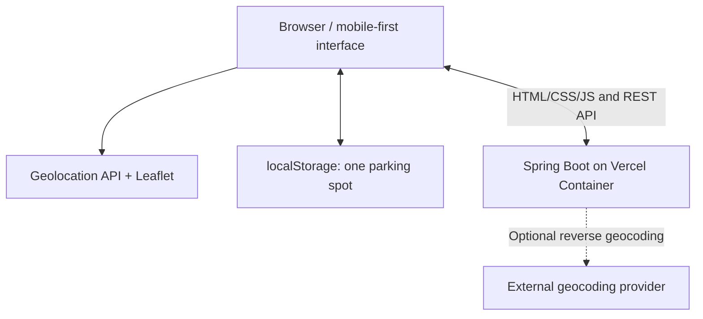

# Where I Parked 🚗📍

**A mobile-first web app that helps you remember where you parked and find your car later.**

**Language:** English | [Português (Brasil)](README.pt-BR.md)

[](https://whereiparked-eta.vercel.app/)
[](https://github.com/brunoloubraz/whereiparked/actions/workflows/ci.yml)


**🌐 [Try Where I Parked](https://whereiparked-eta.vercel.app/)**

## About the project

**Where I Parked** started with a simple idea: remembering where you left your car without creating an account or relying on remote storage.

The app uses the browser's geolocation capabilities to mark a spot on a map and stores **one parking location in `localStorage`**. When you reopen the site in the same browser and on the same origin, the saved location is restored—even if your current location is unavailable.

The MVP combines a lightweight JavaScript frontend with a REST API built using **Java 21 and Spring Boot**. The backend serves the web app and provides an optional reverse-geocoding integration (coordinates → approximate address).

## Features

- 📍 **Current location:** displays your position on a map, including estimated location accuracy when available.
- 🚗 **Parked:** obtains a fresh location reading and saves your parking spot.
- 🗺️ **Distinct markers:** visually separates your parked car from your current location.
- 💾 **Local persistence:** restores the saved parking spot when you reopen the app in the same browser and origin.
- 🔄 **Replace parking spot:** saves a new location without keeping a history.
- 🗑️ **Remove parking spot:** deletes the saved location after confirmation.
- 🏠 **Approximate address (optional):** the API supports reverse geocoding when a compatible provider is configured.

## How to use

1. Open the [live app](https://whereiparked-eta.vercel.app/) on your phone and allow location access.
2. Tap **Parked** to save your car's location.
3. When you need to find your car, reopen the same URL in the same browser and check its marker on the map.
4. Once you leave, tap **Remover marcação** (*Remove parking spot*) and confirm.

> **Note:** Parking data is stored in your browser's `localStorage`, not on a server. It is not shared across browsers, devices, or origins. Clearing site data may remove the saved spot.

## Tech stack and architecture

| Layer | Technologies |
| --- | --- |
| Frontend | HTML5, CSS3, vanilla JavaScript, Leaflet |
| Maps and location | OpenStreetMap, Geolocation API |
| Backend | Java 21, Spring Boot 4.1.2, REST Client |
| Persistence | `localStorage` (no database) |
| Testing | JUnit, Mockito, MockMvc, `node:test` |
| Infrastructure | Multi-stage Docker, GitHub Actions, Vercel Container |



The browser handles the core parking functionality. **The backend does not store parking locations**: it serves the application and exposes an address lookup endpoint with input validation, error handling, caching, and request throttling.

## Run locally

**Prerequisites:** JDK 21. The Maven Wrapper is included in the repository.

```bash
git clone https://github.com/brunoloubraz/whereiparked.git
cd whereiparked
./mvnw spring-boot:run
```

Open **http://localhost:8080**. On Windows, use `mvnw.cmd` instead of `./mvnw`.

### Run with Docker

```bash
docker build -t whereiparked:local .
docker run --rm -p 8080:8080 -e PORT=8080 whereiparked:local
```

The application reads the `PORT` environment variable and defaults to `8080`.

## REST API

Spring Boot exposes this endpoint:

```http
GET /api/location/reverse?lat=-23.5614&lon=-46.6559
```

It validates coordinates and, when the external integration is enabled, returns approximate address information. The API includes error handling and per-instance request limiting.

**Reverse geocoding is intentionally disabled in the current public deployment.** Without `GEOCODING_USER_AGENT`, a valid lookup returns `503 GEOCODING_UNAVAILABLE`. This **does not affect** saving, restoring, or removing a parking spot.

Using a public geocoding provider requires reviewing its usage and privacy policies first. The current rate limiter and cache operate per instance, not globally across multiple container instances.

## Testing and CI

```bash
# Java tests
./mvnw clean verify

# JavaScript tests (Node.js 24 in CI)
node --test src/test/js/*.test.cjs
```

[GitHub Actions](.github/workflows/ci.yml) runs three independent jobs: Java tests, JavaScript tests, and a Docker image build with HTTP smoke tests.

## Deployment

Frontend and backend are deployed **together on Vercel**, using the **Container** runtime and the repository's root `Dockerfile`, with `PORT=8080`.

- **Live application:** https://whereiparked-eta.vercel.app/
- **Configuration:** [`vercel.json`](vercel.json)
- **CI pipeline:** [GitHub Actions](.github/workflows/ci.yml)

The project uses Vercel Hobby for personal learning purposes, subject to the plan's current limits and terms.

## Development documentation

The incremental specifications that guided development are available in [`docs/step/`](docs/step/), covering the mobile-first interface, maps and geolocation, reverse-geocoding API, local persistence, automated testing, parking removal, and deployment.

[`AGENTS.md`](AGENTS.md) contains instructions for coding agents working on this repository.

## Current limitations

- **One parking spot per browser/origin:** no account, history, or cross-device synchronization.
- Location access requires permission in a compatible browser; outside `localhost`, geolocation requires a secure context (HTTPS).
- Map rendering depends on external Leaflet/OpenStreetMap resources.
- Approximate address lookup is optional and currently disabled in the public deployment.
- Vercel's Container runtime may experience cold starts after periods of inactivity.

---

**A personal project built to practice web development, REST APIs with Java, automated testing, containerization, and deployment.**
