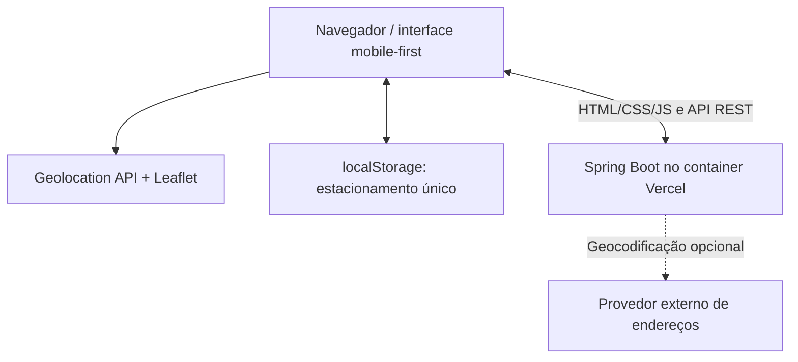

# Where I Parked 🚗📍

**Um aplicativo web mobile-first para salvar onde você estacionou e encontrar seu carro depois.**

**Idioma:** [English](README.md) | Português (Brasil)

[](https://whereiparked-eta.vercel.app/)
[](https://github.com/brunoloubraz/whereiparked/actions/workflows/ci.yml)


**🌐 [Acessar o Where I Parked](https://whereiparked-eta.vercel.app/)**

## Sobre o projeto

O **Where I Parked** nasceu de uma necessidade simples: lembrar onde o carro foi estacionado sem depender de uma conta, cadastro ou serviço de armazenamento remoto.

A aplicação utiliza a geolocalização do navegador para marcar um ponto no mapa e guarda **um único estacionamento no `localStorage`**. Ao reabrir o site no mesmo navegador e domínio, o ponto salvo pode ser recuperado, mesmo sem acesso à localização atual.

O MVP combina uma interface leve em JavaScript com uma API REST em **Java 21 e Spring Boot**. O backend é responsável por servir o frontend e disponibilizar uma integração opcional de geocodificação reversa (coordenadas → endereço aproximado).

## Funcionalidades

- 📍 **Localização atual:** exibe a posição do dispositivo no mapa, com indicação da precisão estimada quando disponível.
- 🚗 **Parked:** captura uma nova posição e salva o local do estacionamento.
- 🗺️ **Marcadores distintos:** diferencia o carro estacionado da localização atual.
- 💾 **Persistência local:** restaura o estacionamento ao reabrir a aplicação no mesmo navegador e origem.
- 🔄 **Substituição:** permite registrar um novo estacionamento sem criar histórico.
- 🗑️ **Remover marcação:** exclui o ponto salvo mediante confirmação.
- 🏠 **Endereço aproximado (opcional):** a API oferece geocodificação reversa quando um provedor compatível está configurado.

## Como usar

1. Abra o [aplicativo](https://whereiparked-eta.vercel.app/) no celular e permita o acesso à localização.
2. Toque em **Parked** para salvar o local do carro.
3. Quando precisar voltar, abra o mesmo endereço no mesmo navegador e consulte a marcação no mapa.
4. Ao retirar o carro, toque em **Remover marcação** e confirme.

> **Importante:** os dados ficam no `localStorage` do navegador, não no servidor. Navegadores, dispositivos e domínios diferentes não compartilham a marcação; limpar os dados do site pode apagá-la.

## Tecnologias e arquitetura

| Camada | Tecnologias |
| --- | --- |
| Frontend | HTML5, CSS3, JavaScript (vanilla), Leaflet |
| Mapa e localização | OpenStreetMap, Geolocation API |
| Backend | Java 21, Spring Boot 4.1.2, REST Client |
| Persistência | `localStorage` (sem banco de dados) |
| Testes | JUnit, Mockito, MockMvc e `node:test` |
| Infraestrutura | Docker multi-stage, GitHub Actions, Vercel Container |



O navegador executa a funcionalidade principal de estacionamento. O backend não armazena a posição do carro: ele serve a aplicação e oferece o endpoint de consulta de endereço, com validação, tratamento de erros, cache e controle de chamadas externas.

## Executar localmente

**Pré-requisitos:** JDK 21. O Maven Wrapper está incluído no repositório.

```bash
git clone https://github.com/brunoloubraz/whereiparked.git
cd whereiparked
./mvnw spring-boot:run
```

Acesse **http://localhost:8080**. No Windows, utilize `mvnw.cmd` em vez de `./mvnw`.

### Com Docker

```bash
docker build -t whereiparked:local .
docker run --rm -p 8080:8080 -e PORT=8080 whereiparked:local
```

A aplicação usa a variável `PORT`, com valor padrão `8080`.

## API REST

O Spring Boot expõe o endpoint:

```http
GET /api/location/reverse?lat=-23.5614&lon=-46.6559
```

Ele valida coordenadas e, quando a integração externa está habilitada, responde com informações de endereço aproximado. A API inclui tratamento de erros e limitações locais de consultas.

**No deploy público atual, a geocodificação está desabilitada intencionalmente.** Sem `GEOCODING_USER_AGENT` configurado, uma consulta válida retorna `503 GEOCODING_UNAVAILABLE`. Isso **não impede** salvar, recuperar ou remover a marcação do carro.

O uso de um provedor público de geocodificação requer avaliação prévia de suas condições de utilização e de privacidade. O controle de taxa e o cache atuais são por instância, não globais para múltiplas instâncias do container.

## Testes e CI

```bash
# Testes Java
./mvnw clean verify

# Testes JavaScript (Node.js 24 no CI)
node --test src/test/js/*.test.cjs
```

O [GitHub Actions](.github/workflows/ci.yml) executa três jobs independentes: testes Java, testes JavaScript e build/smoke test do container Docker.

## Deploy

Frontend e backend são publicados **juntos na Vercel**, usando o runtime **Container** e o `Dockerfile` da raiz, com `PORT=8080`.

- **Aplicação:** https://whereiparked-eta.vercel.app/
- **Configuração:** [`vercel.json`](vercel.json)
- **Pipeline:** [GitHub Actions](.github/workflows/ci.yml)

O projeto utiliza o plano Hobby para fins pessoais e de aprendizado, sujeito aos limites e às condições vigentes da Vercel.

## Documentação do desenvolvimento

As especificações incrementais que orientaram o desenvolvimento estão preservadas em [`docs/step/`](docs/step/): interface mobile-first, geolocalização, API de geocodificação, persistência local, testes, remoção de estacionamento e deploy.

O arquivo [`AGENTS.md`](AGENTS.md) reúne instruções para agentes de desenvolvimento e manutenção do repositório.

## Limitações atuais

- Apenas **um estacionamento por navegador/origem**, sem login, histórico ou sincronização entre dispositivos.
- É necessário permitir a geolocalização em um navegador compatível; fora de `localhost`, esse recurso exige contexto seguro (HTTPS).
- O mapa depende da disponibilidade dos recursos externos do Leaflet/OpenStreetMap.
- O endereço aproximado é opcional e não está habilitado no deploy público atual.
- O runtime Container da Vercel pode apresentar inicialização a frio após períodos de inatividade.

---

**Projeto pessoal desenvolvido para praticar desenvolvimento web, APIs REST em Java, testes automatizados, containerização e deploy.**
